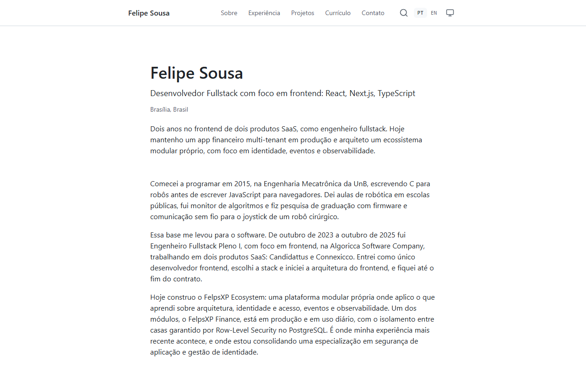
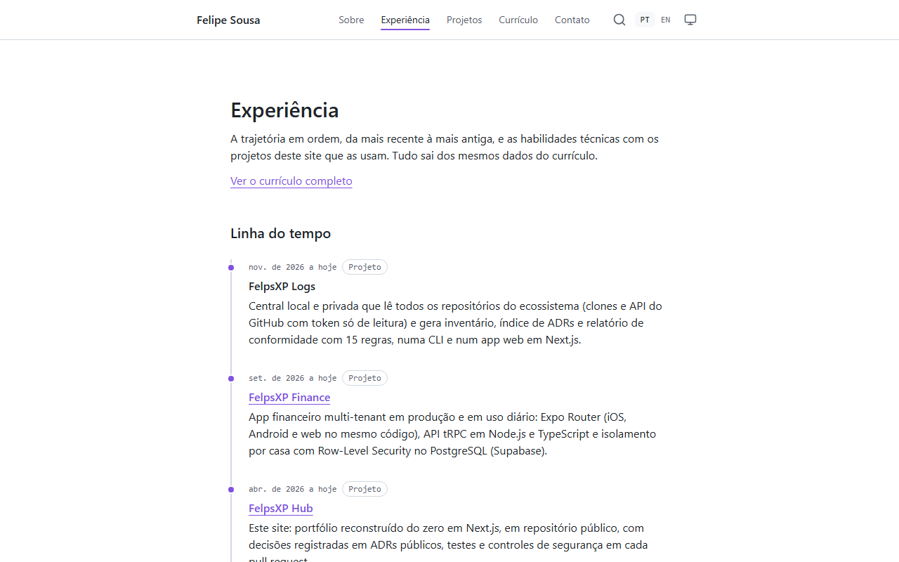
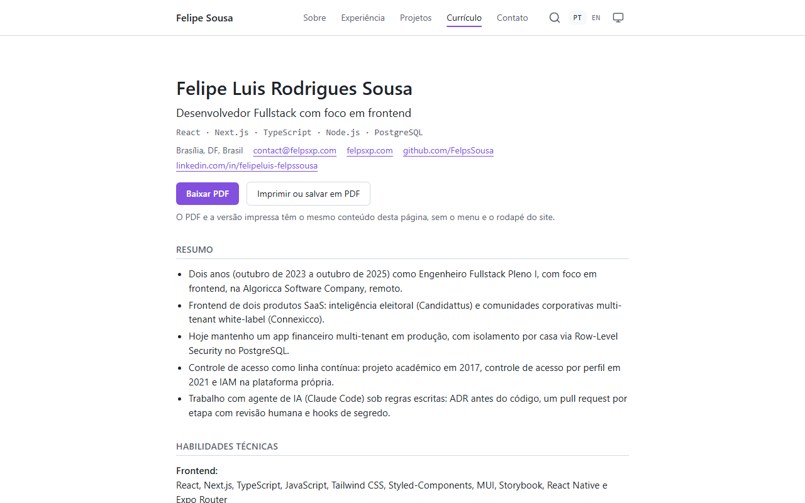
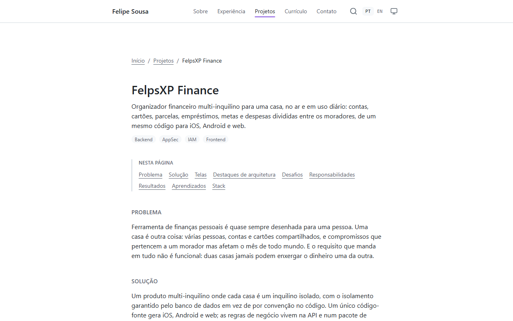

# felpsxp-hub

> O código-fonte de [felpsxp.com](https://felpsxp.com): o portfólio de Felipe Sousa, construído
> como uma aplicação web pequena, em padrão de produção, com segurança e acessibilidade
> verificadas a cada pull request.

[English](README.md) · **Português (BR)**

[](https://github.com/FelpsSousa/felpsxp-hub/actions/workflows/ci.yml)
[](https://github.com/FelpsSousa/felpsxp-hub/actions/workflows/codeql.yml)
[](https://scorecard.dev/viewer/?uri=github.com/FelpsSousa/felpsxp-hub)
[](LICENSE)

Parte do **ecossistema digital FelpsXP** · ID no registro: `FXP-003`

---

## O que é

Um portfólio bilíngue (português e inglês): sobre, experiência, currículo com download em PDF,
projetos, formulário de contato e as políticas de privacidade e de segurança. Enxuto em
funcionalidades e rigoroso em engenharia: o próprio repositório foi feito para ser lido, então
cada decisão está registrada, cada controle de segurança tem teste e o histórico é uma
sequência de pull requests pequenos e revisados.

<table>
<tr>
<td width="50%"><picture><source media="(prefers-color-scheme: dark)" srcset="docs/images/readme/pt-dark-home.png"></picture></td>
<td width="50%"><picture><source media="(prefers-color-scheme: dark)" srcset="docs/images/readme/pt-dark-experience.png"></picture></td>
</tr>
<tr>
<td width="50%"><picture><source media="(prefers-color-scheme: dark)" srcset="docs/images/readme/pt-dark-cv.png"></picture></td>
<td width="50%"><picture><source media="(prefers-color-scheme: dark)" srcset="docs/images/readme/pt-dark-project.png"></picture></td>
</tr>
</table>

Telas do site no ar; o GitHub mostra as versões escuras quando o seu tema é escuro.

## Destaques

- **Sem banco e sem login:** nenhuma página pública precisa deles. As páginas são geradas a
  cada requisição para que cada uma leve um nonce novo da CSP; o custo medido foi de cerca de
  10 ms no servidor ([ADR-0009](docs/adr/0009-script-src-without-unsafe-inline.md),
  [Lighthouse](docs/quality/lighthouse.md)).
- **Conteúdo como código:** perfil, projetos e páginas legais em TypeScript validado com Zod
  no build.
- **Decisões antes do código:** toda decisão cara de reverter vira uma
  [ADR](docs/adr/README.md) antes do código (em inglês).
- **Padrão visual com créditos:** baseado no Primer, o design system de código aberto do
  GitHub, com Octicons e duas fontes retrô hospedadas no próprio site como assinatura do
  FelpsXP; o padrão fica ao vivo em [`/design`](https://felpsxp.com/design), e cada recurso
  de terceiros aparece com a sua licença em [`THIRD_PARTY_NOTICES.md`](THIRD_PARTY_NOTICES.md).
- **Versão visível:** versionamento semântico automatizado pelo release-please a partir dos
  Conventional Commits; o rodapé mostra a versão e o commit em produção.
- **Modelo de ameaças STRIDE** com cada mitigação ligada ao PR ou ADR que a implementa
  ([docs/security/threat-model.md](docs/security/threat-model.md)).
- **Headers de segurança testados** em teste unitário e de novo numa resposta real de produção.
- **Formulário de contato endurecido:** Turnstile verificado no servidor, honeypot silencioso,
  validação que barra injeção de cabeçalho, e-mail em texto puro, nada armazenado e eventos de
  segurança anônimos.
- **Cadeia de suprimentos:** gitleaks, CodeQL no código e nos workflows, actions fixadas por SHA
  dependências novas só em versões com algumas semanas de vida e um relatório semanal do
  OpenSSF Scorecard, publicado no selo acima.
- **Testes de ponta a ponta com Playwright e auditoria WCAG 2.2 AA com axe** em todas as páginas,
  nos dois idiomas e nos dois temas, em desktop e mobile.
- **Privacidade desde o desenho (LGPD):** um único cookie de sessão para o idioma, nenhum
  rastreamento e um aviso de privacidade que um teste mantém fiel ao código.

## Como rodar

```bash
git clone https://github.com/FelpsSousa/felpsxp-hub.git
cd felpsxp-hub
pnpm install
pre-commit install --hook-type pre-commit --hook-type commit-msg
cp .env.example .env.local    # o formulário de contato precisa destas variáveis
pnpm dev                      # http://localhost:3000
```

Os demais comandos estão no [README em inglês](README.md#getting-started).

## Segurança

Não abra issue pública para vulnerabilidades. Veja o [SECURITY.md](SECURITY.md) ou escreva para
security@felpsxp.com.

## Licença

[MIT](LICENSE) © 2026 Felipe Sousa · FelpsXP
